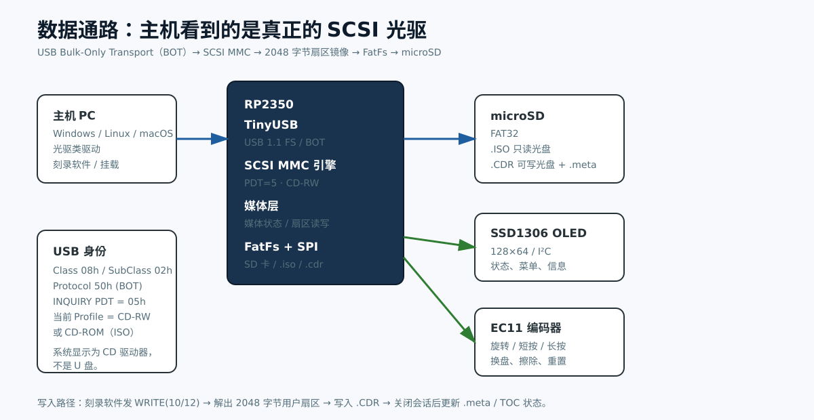

# 架构与协议



## 总览

```
主机 (Windows/Linux/macOS)
   │  USB 1.1 Full-Speed, Bulk-Only Transport
   ▼
TinyUSB device stack
   │  CBW / Data / CSW
   ▼
src/usb_cdrom.c  —— 自写光驱类驱动
   │  SCSI CDB + 数据阶段
   ▼
src/scsi.c  —— MMC 命令子集，PDT=5
   │
   ▼
src/media.c  —— 光盘状态机 / 2048B 扇区
   │
   ├── .ISO：只读，直接映射文件
   └── .CDR：可写，映射 raw 扇区 + .meta sidecar
   │
   ▼
FatFs R0.15 → src/sd_spi.c → microSD (SPI)
```

UI 与 USB 在同一个主循环中协作：

```
for (;;) {
    tud_task();   // 处理 USB 事件和 SCSI 回调
    ui_task();    // 编码器、OLED、菜单
    ...
}
```

因此不需要 RTOS，也不存在 FatFs 重入问题；代价是刻录时 UI 响应会变慢，且新建 700 MiB 镜像会短暂阻塞 USB。

## 为什么必须自写 BOT 类驱动

TinyUSB 自带的 `msc_device` 固定返回 `INQUIRY` PDT=0，并只提供 `read10/write10` 回调。即使把产品字符串改成 “CD-RW”，Windows 仍会按可移动磁盘加载驱动。

本项目在 `usb_cdrom.c` 中注册一个 application class driver：

- USB 描述符仍是 Mass Storage / SCSI / BOT
- `INQUIRY` 返回 `Peripheral Device Type = 0x05`
- 自己实现 CBW 解析、数据阶段、CSW、Bulk-Only Reset、Clear Halt
- 把 SCSI 交给 `scsi.c`，把扇区交给 `media.c`

USB 描述符：

| 字段 | 值 |
|---|---|
| `bcdUSB` | `0x0110`（USB 1.1） |
| 设备类 | 0（类在接口上） |
| 接口类/子类/协议 | `08h / 02h / 50h` |
| 端点 | Bulk OUT `0x01`，Bulk IN `0x81`，64 字节 |
| 供电 | 总线供电，250 mA |
| VID:PID | `1209:CD01`（pid.codes 测试空间；量产请替换） |

> 修改 VID/PID 时同时更新 `src/usb_descriptors.c` 和文档；Windows 会按 VID/PID 缓存设备信息。

## SCSI 命令子集

命令实现在 `src/scsi.c`，所有响应均为 big-endian 字段。

| 命令 | 操作码 | 用途 |
|---|---|---|
| TEST UNIT READY | `00h` | 媒体就绪 |
| REQUEST SENSE | `03h` | 固定格式 sense |
| INQUIRY | `12h` | PDT=5，VPD 00/80/83 |
| MODE SELECT(6/10) | `15h/55h` | 接受写参数页 |
| MODE SENSE(6/10) | `1Ah/5Ah` | 页 01/05/08/0D/2A/3F |
| START STOP UNIT | `1Bh` | 弹出/装载 |
| PREVENT ALLOW | `1Eh` | 媒体锁 |
| READ FORMAT CAPACITIES | `23h` | 格式化容量 |
| READ CAPACITY(10) | `25h` | 2048B 扇区数 |
| READ(10/12) | `28h/A8h` | 读取用户数据 |
| WRITE(10/12) | `2Ah/AAh` | 刻录写入 |
| WRITE AND VERIFY | `2Eh/AEh` | 按写处理 |
| VERIFY(10/12) | `2Fh/AFh` | 空操作成功 |
| SYNCHRONIZE CACHE | `35h` | f_sync + sidecar |
| READ TOC/PMA/ATIP | `43h` | 格式 0/1/2 |
| READ HEADER | `44h` | 当前 LBA 的 MSF |
| GET CONFIGURATION | `46h` | Profile/Feature |
| GET EVENT STATUS | `4Ah` | 媒体插拔事件 |
| READ DISC INFORMATION | `51h` | 盘片状态 |
| READ TRACK INFORMATION | `52h` | NWA/Free Blocks |
| RESERVE TRACK | `53h` | TAO 预留 |
| SEND OPC | `54h` | 接受 |
| CLOSE TRACK/SESSION | `5Bh` | 关闭轨道/会话 |
| READ BUFFER CAPACITY | `5Ch` | 兼容查询 |
| BLANK | `A1h` | 擦除 |
| GET PERFORMANCE | `ACh` | 最小响应 |
| SET CD SPEED | `BBh` | 限速 |
| MECHANISM STATUS | `BDh` | 托盘状态 |
| READ CD | `BEh` | cooked user-data |

未实现/不支持的命令返回 `CHECK CONDITION / ILLEGAL REQUEST / INVALID COMMAND`。

### INQUIRY 关键字段

| 字节 | 值 | 含义 |
|---|---|---|
| 0 | `0x05` | 外设类型 CD-ROM，qualifier 0 |
| 1 | `0x80` | RMB=1，可移动 |
| 2 | `0x05` | SPC-3 |
| 3 | `0x02` | Response Data Format 2 |
| 4 | `0x1F` | Additional Length = 31 |
| 8..15 | `RP2350  ` | Vendor |
| 16..31 | `CD-RW USB 1.1   ` | Product |
| 32..35 | `1.00` | Revision |

### GET CONFIGURATION

返回的 Feature Descriptor：

- `0000h` Profile List：`000Ah` CD-RW、`0008h` CD-ROM
- `0001h` Core（SCSI family）
- `0002h` Morphing（polled event）
- `0003h` Removable Medium（tray/eject/lock）
- `0004h` Write Protect
- `0010h` Random Readable（2048B）
- `001Dh` Multi-Read
- `001Eh` CD Read
- `0021h` Incremental Streaming Writable（2048B，link size 7）
- `0023h` Formattable
- `0026h` Restricted Overwrite
- `0027h` CD-RW CAV Write
- `002Dh` CD Track At Once

当 ISO 只读盘插入时，`Current Profile = 0008h`，`000Ah` 的 CurrentP 清零，写入相关 Feature 的 Current 位清零。

### READ DISC INFORMATION

34 字节标准响应：

- `Disc Status`：空盘 0、未完成 1、完成 2
- `State of Last Session`：空 0、未完成 1、完成 3
- `Erasable`：CD-RW 且可写时为 1
- 第一轨/最后轨 1，会话数 1（空盘 0）
- `URU = 1`
- Lead-out 位置参考 `data_lba`

### TOC

- Format 0：Track 1（数据，control `04h`）+ Lead-out（`AAh`）
- Format 1：单会话
- Format 2：A0/A1/A2 原始 TOC
- MSF 采用 `LBA + 150` 换算，二进制 M/S/F

## 光盘状态机

```
                media_load(.iso)
        ┌──────────────────────────► READ_ONLY
        │                               complete, wp=1
        │
NO_MEDIA ── media_load(.cdr) ──► BLANK
        │                          blank=1
        │                              │ WRITE
        │                              ▼
        │                         INCOMPLETE
        │                          session_open=1
        │                              │ CLOSE SESSION
        │                              ▼
        │                          COMPLETE
        │                              │ BLANK/Erase
        └──────────────────────────────┘
```

### 写入流程（典型 TAO）

```
MODE SELECT(05h)       设置 write type / data block type
RESERVE TRACK          预留 LBA 0..N
WRITE(10) ...          每个 CBW 携带 N×2048 用户字节
SYNCHRONIZE CACHE      落盘
CLOSE TRACK/SESSION    标记 complete，更新 sidecar
```

固件并不“理解 ISO”：它只保存主机发来的 2048 字节用户扇区。刻录 ISO 后，光盘的 PVD/TOC 是镜像本身的内容，操作系统按普通 CD 读取。

### 擦除

`BLANK` 的 blanking type 0/1/4 被接受，执行逻辑擦除：

- 清空 `data_lba`、`nwa`
- 标记 `blank`
- 后续 `READ` 对空白区域返回全 0
- 不实际擦除 SD 上的旧数据（快速擦除语义）

## `.CDR` 镜像与 sidecar

### 镜像

- 文件大小 = `capacity_lba × 2048`
- 偏移 = `LBA × 2048`
- 只含用户数据，无同步头、Header、EDC/ECC
- 默认 700 MiB = 358400 扇区

设备可以使用 `f_expand` 一次预分配，避免刻录过程中 FAT 分配失败。主机工具使用 `posix_fallocate`，失败时退化为写零。

### `.meta`

文件：`<image>.meta`，固定 48 字节，little-endian：

| 偏移 | 类型 | 字段 |
|---|---|---|
| 0 | `char[8]` | `RPCDRW01` |
| 8 | `u16` | version = 1 |
| 10 | `u16` | flags |
| 12 | `u32` | capacity_lba |
| 16 | `u32` | data_lba（lead-out） |
| 20 | `u32` | nwa |
| 24 | `u32` | track_start |
| 28 | `u32[4]` | reserved |
| 44 | `u32` | CRC32（前 44 字节） |

Flags：

```
bit0  BLANK
bit1  COMPLETE
bit2  SESSION_OPEN
bit3  WRITE_PROTECTED
```

没有 sidecar 时，固件会从内容推断：

- 扇区 16 有 `CD001` → ISO9660，读取 PVD 的 Volume Space Size
- 扇区 16 有 `BEA01` → UDF，按整盘已录制
- 首扇区非零 → 视为 raw/audio 数据
- 全零 → 空白盘

## 缓冲与吞吐

- USB Bulk 端点 64 字节，FS 帧 1 ms
- 每次 SCSI 数据阶段使用 32 KiB 暂存
- WRITE 原始扇区转换：
  - 2048 → 直接
  - 2352/2368/2448 → 根据 Mode 字节偏移 16 或 24 取 2048
  - 2336/2324 → 偏移 0
  - 2056/2332 → 偏移 8
- 4x CD = 600 KiB/s；USB 1.1 理论约 1.1 MiB/s，实测余量有限
- microSD SPI 25 MHz，持续读写通常高于 1 MiB/s

## 参考

- [T10 MMC-4 命令集草案](https://www.cs.rit.edu/usr/local/pub/wrc/doc/hardware/scsi/scsi3/cmdsets/mmc4r01g.pdf)
- [TinyUSB](https://github.com/hathach/tinyusb)
- [FatFs](https://elm-chan.org/fsw/ff/)
- [RP2350 数据手册](https://datasheets.raspberrypi.com/rp2350/rp2350-datasheet.pdf)
