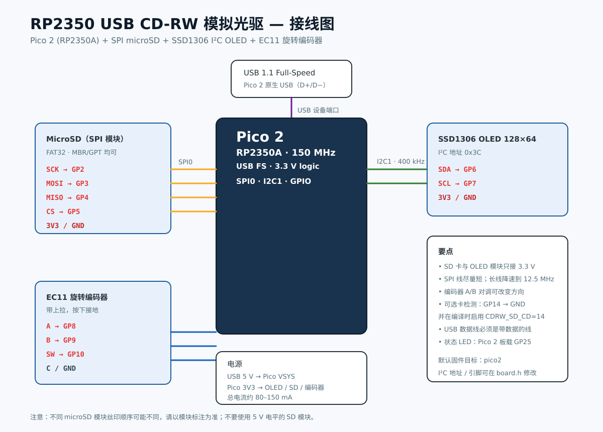

# 硬件与接线



## 物料清单

| 数量 | 物料 | 说明 |
|---|---|---|
| 1 | Raspberry Pi Pico 2 / RP2350A 板 | 默认构建目标 `pico2`；其他 RP2350 板需改 `PICO_BOARD` 和引脚 |
| 1 | microSD SPI 模块 | 3.3 V 供电；必须支持 SPI 模式 |
| 1 | microSD 卡 | FAT32；建议 8 GB 以上；镜像单张 700 MiB |
| 1 | SSD1306 128×64 I²C OLED | 地址 `0x3C`；4 针模块 |
| 1 | EC11 旋转编码器（带按压） | 5 针：A/B/C/SW/另一侧 SW |
| 1 | USB 数据线 | 能传数据，不是纯充电线 |
| 1 | 外壳 | 可用旧 CD-RW 外壳、3D 打印盒或亚克力板 |

## 接线表

| Pico 2 引脚 | 连接到 | 备注 |
|---|---|---|
| GP2 | microSD `SCK` | SPI0 SCK |
| GP3 | microSD `MOSI` | 主出从入 |
| GP4 | microSD `MISO` | 主入从出 |
| GP5 | microSD `CS` | 片选，低有效 |
| GP6 | OLED `SDA` | I2C1 SDA |
| GP7 | OLED `SCL` | I2C1 SCL |
| GP8 | 编码器 `A` | 内部上拉 |
| GP9 | 编码器 `B` | 内部上拉 |
| GP10 | 编码器 `SW` | 内部上拉，按下接 GND |
| 3V3 (OUT) | OLED `VCC`、SD `VCC`、编码器 `+` | **3.3 V，不能接 5 V** |
| GND | OLED `GND`、SD `GND`、编码器 `GND` | 必须共地 |
| GP25 | 板载 LED | Pico 2 自带；不需要外接 |
| USB | 电脑 | Pico 2 原生 USB，全速 12 Mbps |

> **SD 的 GP2–GP5 不能按“CS、SCK、MOSI、MISO”顺序随意改。**
> RP2350 的 SPI0 硬件固定映射为：
>
> ```text
> GP2 = SCK
> GP3 = MOSI/TX
> GP4 = MISO/RX
> GP5 = CSn（本项目用普通 GPIO 手动片选）
> ```
>
> 正确接法是：
>
> ```text
> SD CS   -> GP5
> SD SCK  -> GP2
> SD MOSI -> GP3
> SD MISO -> GP4
> ```
>
> 如果接成 `CS-GP2 / SCK-GP3 / MOSI-GP4 / MISO-GP5`，硬件 SPI 无法工作；
> 这不是改 `board.h` 能解决的，需要改用 PIO/软件 SPI，性能和稳定性都会下降。

可选的 SD 卡检测开关：

- 卡座 CD 引脚接 **GP14**，插卡时对 GND。
- 默认固件为了兼容没有 CD 引脚的模块，关闭了卡检测（`CDRW_SD_CD = -1`）。
- 启用方法：把 `src/board.h` 中的 `CDRW_SD_CD` 改为 `14`，或配置时加 `-DCDRW_SD_CD=14`：

```bash
cmake -S . -B build -G Ninja -DPICO_BOARD=pico2 \
    -DPICO_SDK_PATH="$PWD/third_party/pico-sdk" -DCDRW_SD_CD=14
```

## 模块差异

### microSD SPI 模块

> **蓝色“MicroSD Card Adapter”特别注意**：如果模块背面有 `AMS1117-3.3` 和 `74LVC125A`，它通常是 **5 V 供电型**（板载 LDO 给 SD 卡供 3.3 V，电平转换器输出仍应为 3.3 V）。这种模块的 `VCC` 接 Pico 的 **VBUS/5 V（物理 40 脚）**，不是 3V3；接 3V3 可能导致卡供电不足而 `SD INIT FAIL`。上电前必须测量模块信号脚高电平，确认不超过 3.3 V；若输出 5 V，不能直连 Pico。
>
> 如果模块背面没有稳压器/电平转换芯片（只有上拉电阻），则 `VCC` 接 **3V3**，绝不能接 5 V。分不清时先拍背面照片确认。

常见模块的丝印顺序不一致，可能是：

```
CS  SCK  MOSI  MISO  VCC  GND
```

也可能是 `GND VCC MISO MOSI SCK CS`。**以模块丝印为准**。模块若有 3.3 V 稳压器和电平转换器，仍然建议 `VCC` 接 Pico 的 3V3，而不是 5 V，避免信号电平不匹配。

SPI 线建议短于 10 cm。25 MHz 对杜邦线可能偏高；如果出现 `NO MICROSD` 或读写错误，把 `src/board.h` 中：

```c
#define CDRW_SD_SPI_HZ (25 * 1000 * 1000)
```

改成：

```c
#define CDRW_SD_SPI_HZ (12 * 1000 * 1000)
```

### OLED

- 标准 SSD1306 模块地址通常为 `0x3C`，少数为 `0x3D`。
- 修改 `src/board.h` 的 `CDRW_OLED_ADDR`。
- 模块一般自带 I²C 上拉；若使用裸屏，需要 4.7 kΩ 上拉到 3.3 V。
- SH1106 与 SSD1306 初始化序列不同，本项目默认不支持 SH1106。

### 编码器

常见有两种丝印：

**KY-040 五针模块（照片中的类型）**：`CLK / DT / SW / + / GND`

| 模块 | Pico 2 |
|---|---|
| `CLK`（A 相） | GP8 |
| `DT`（B 相） | GP9 |
| `SW` | GP10 |
| `+` | 3V3 |
| `GND` | GND |

模块背面通常有 R1/R2/R3 三个 10 kΩ 上拉电阻，因此不需要外部电阻。**`+` 只能接 3.3 V**；接 5 V 会让 CLK/DT/SW 输出 5 V，可能损坏 RP2350。

**裸 EC11**：`A`、`B`、`C`（公共端接 GND）、`SW`、另一侧 `SW`（接 GND），使用 Pico 内部上拉。

- 若旋转方向相反，交换 CLK/DT（或 A/B）两根线，或修改 `board.h` 中的 `CDRW_ENC_A/B`。
- 消抖阈值在 `src/encoder.c` 的 `CDRW_ENCODER_TRANSITIONS_PER_DETENT`，默认 4 个跳变/格。部分编码器是 2，可改为 2。

## 调试串口（UART0）

固件启用了 UART0 日志，方便复制 SD 初始化、光盘状态、SCSI 命令和错误信息。

| Pico 2 引脚 | 连接到 USB-UART | 说明 |
|---|---|---|
| GP0（物理 1 脚） | 模块 `RXD` | Pico TX → 模块 RX |
| GP1（物理 2 脚） | 模块 `TXD` | 可选；Pico RX |
| GND | 模块 `GND` | 必须共地 |

串口参数：

```
115200 8N1，无流控
```

注意：

- USB-UART 模块必须用 **3.3 V 逻辑**；5 V 逻辑会损坏 RP2350。
- Pico 已由 USB 供电时，不要再把 USB-UART 的 VCC 接到 Pico 的 5V/3V3。
- 打开串口助手后按一下 Pico 的 RUN/重新上电，才能看到启动日志。
- 日志示例：
  ```
  RP2350 CD-RW emulator v1.0.8
  [     120] storage: SD initialized, mounting FatFs
  [     145] SD: init OK, type=SDSC, blocks=...
  [     150] media: opened /discs/DISC01.CDR (734003200 bytes)
  [     152] media: CD-RW BLANK cap=358400 data=0 nwa=0 meta=yes
  [    1200] CBW op=2A dir=OUT len=65536 ...
  [    1203] WRITE lba=0 blocks=32 src=2048 discard=0 data=65536
  ```

## 电源与 USB

- 整机由 Pico 2 的 USB 5 V 供电，3V3 稳压器给外设。
- 估算电流：RP2350 约 50 mA，OLED 约 20 mA，microSD 峰值约 100 mA，编码器可忽略；总电流通常低于 200 mA。
- USB 描述符声明 250 mA，兼容大多数主机。
- 不要同时从外部 5 V 和 USB 给 VSYS 供电，除非你清楚 Pico 的电源路径。
- 使用带屏蔽/较短 USB 线；USB 1.1 对线材不苛刻，但劣质线会导致枚举失败。

## 外壳建议

- 前面板开孔：0.96" OLED 窗口、EC11 旋钮孔、5 mm LED 导光孔。
- 后面板：USB 出线孔或面板式 USB 延长线。
- microSD 卡座可以放在侧面，方便换卡；注意不要挡住 USB。
- 如果复用旧 CD-RW 外壳，可以把 Pico、SD 模块、OLED 和编码器固定在托架上；不需要真实激光组件。

## 引脚修改

所有关键引脚在 `src/board.h` 中集中定义：

```c
#define CDRW_SD_SCK   2
#define CDRW_SD_MOSI  3
#define CDRW_SD_MISO  4
#define CDRW_SD_CS    5
#define CDRW_OLED_SDA 6
#define CDRW_OLED_SCL 7
#define CDRW_ENC_A    8
#define CDRW_ENC_B    9
#define CDRW_ENC_BTN  10
```

注意不要占用 Pico 2 的 USB 引脚（GP12/13 在板内连接）和板载 LED（GP25）。
